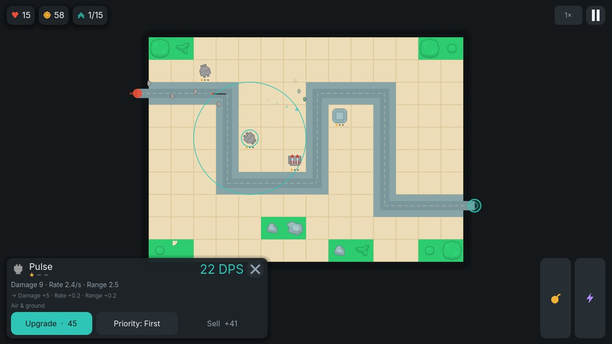
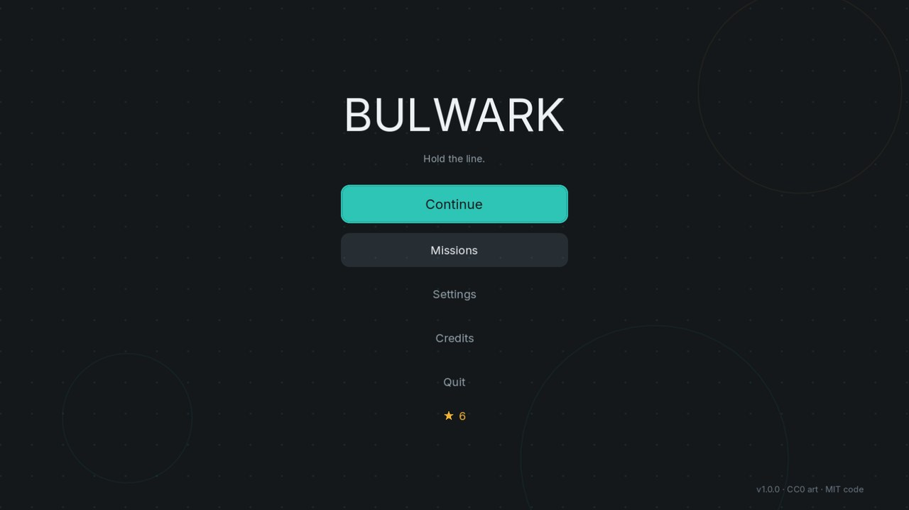
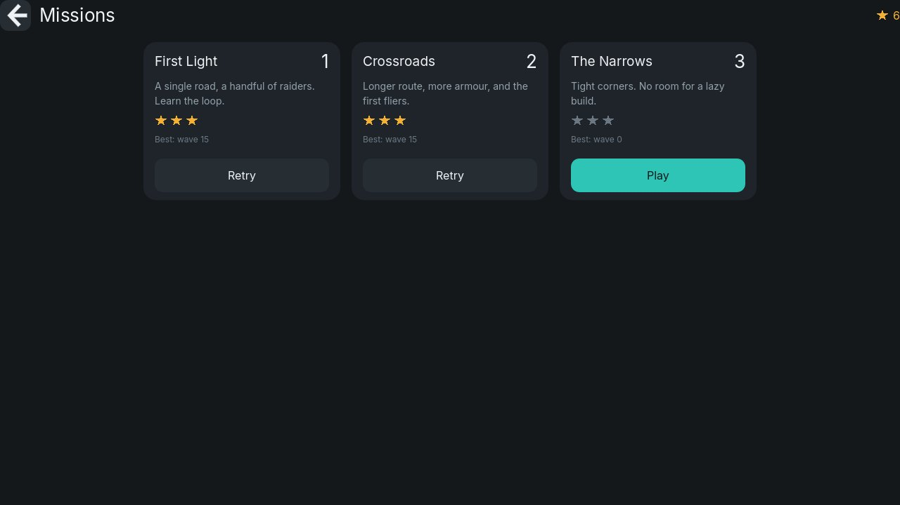
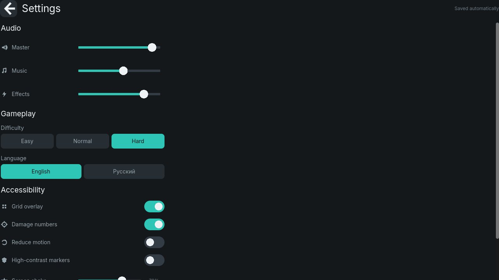
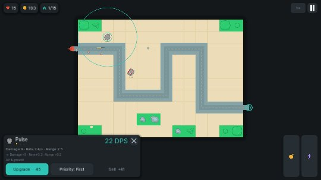

# Bulwark

**A minimalist tower defense for Android and desktop.**
Flat, high-contrast art. Six towers, seven enemy types, fifteen waves per mission, three
missions. One small, readable codebase — built to be forked.

<p align="center">
  
</p>

<p align="center">
  <a href="docs/screenshots/menu.jpg"></a>
  <a href="docs/screenshots/missions.jpg"></a>
  <a href="docs/screenshots/settings.jpg"></a>
  <a href="docs/screenshots/portrait.jpg"></a>
</p>

---

## What it is

You hold a road. Enemies walk it; your towers shoot them. Between waves you spend gold on
towers, upgrades and modules. Enemies that reach the exit cost lives — and their bounty, so
leaking hurts twice. Clear all fifteen waves to keep the sector.

It is deliberately **small and complete** rather than large and shallow: every system that
makes a modern tower defense work is here, and nothing that does not.

| | |
|---|---|
| **Platforms** | Android (phone/tablet, landscape), Windows, Linux, and Web |
| **Engine** | Godot 4.7 (GDScript, Compatibility renderer — one rendering path on every target) |
| **Code** | ~5,000 lines of typed GDScript + JSON content, no plugins or addons |
| **Tests** | 167 unit assertions, a level smoke test, and an autoplay balance harness |
| **Licence** | Code MIT · Art, SFX CC0 (Kenney) · Font OFL (Inter) · Music generated (CC0) |

## Features

**Core loop** — prepare → call the wave → auto-firing towers → bounty → upgrade → harder wave.
Waves are data-driven and telegraphed: the next composition is always visible before you commit.

**Towers that ask different questions**

| Tower | Role | Counter-play it creates |
|---|---|---|
| **Pulse** | cheap rapid fire, hits air | your baseline; falls off against armour |
| **Cannon** | splash, ground only | shreds swarms, cannot touch fliers |
| **Frost** | area slow, low damage | turns a corridor into a kill zone |
| **Arc** | chain lightning | rewards tight clusters |
| **Rail** | long range, armour pierce | deletes brutes before they arrive |
| **Beacon** | support aura | buffs neighbouring towers instead of firing |

**Depth that stays legible**

- Three upgrade levels per tower, with the *next* level's numbers shown before you pay.
- At max level, a **mutually exclusive module** — Cluster vs Bunker-buster, Mark vs Sabot.
- Per-tower **targeting priority** (first / last / closest / strongest / weakest).
- **Armour** (flat) and **resistances** (percentage) so no single tower answers everything.
- **Fliers** cut the corners of the route: only anti-air towers can reach them.
- **Menders** heal nearby enemies; **Colossi** split into swarms when they die.
- Two **active abilities** (targeted airstrike, overclock) on cooldowns, for skill expression.
- **Economy**: kill bounty, wave bonus, banked-gold interest (capped), 75 % sell refund,
  and a bonus for **calling the next wave early** — waiting is a choice, not a free move.

**Comfort and accessibility**

- Landscape-first layout that also adapts to portrait and ultrawide (aspect `keep`).
- Full touch, mouse and keyboard control; every screen is focus-navigable.
- Volume buses, **screen-shake slider (can be 0)**, **reduce motion**, grid overlay,
  damage-number toggle, high-contrast markers, English **and** Russian.
- Crash-safe versioned save file (atomic write + backup + migration), progress autosaved.
- 60 FPS friendly: no per-frame allocation in hot paths, pooled audio, one draw pass for FX.

## Play it

### Android (primary target)

```bash
# build (see "Build from source" below), then:
adb install -r release/bulwark-1.0.0-android.apk
```

Or copy the APK to the phone and open it (you will need to allow installs from unknown
sources — the release APK in `release/` is signed with a debug key for testing only).

### Desktop

Grab a build from GitHub Releases, or build it yourself:

```bash
godot --path . --export-release "Windows" build/windows/bulwark.exe
godot --path . --export-release "Linux"   build/linux/bulwark.x86_64
```

### Web (no install)

The web export is plain static files (`release/web/`). It needs a real HTTP server — opening
`index.html` from the filesystem will not work:

```bash
python3 tools/serve_web.py --port 8080              # http://localhost:8080
python3 tools/serve_web.py --gzip --port 8080       # same, but serves ~10 MB gzip instead of 40 MB
```

`tools/serve_web.py` sets `application/wasm` and the COOP/COEP headers Godot's web export
needs, and serves pre-compressed `.gz` siblings when the browser accepts them. Any static host
works too — just make sure `.wasm` is not served as `text/plain`.

## Controls

| Action | Touch | Mouse / keyboard | Gamepad |
|---|---|---|---|
| Build | pick a tower, tap a tile | click a tower, click a tile | stick + A |
| Inspect / upgrade / sell | tap a tower | click a tower | A on tower |
| Cycle targeting priority | “Priority” button | in the tower panel | in the tower panel |
| Call the next wave early | “Call wave” | `N` | — |
| Game speed (1× / 2× / 3×) | top-right | `Space` | — |
| Abilities | bottom-right buttons | `Q` (airstrike), `W` (overclock) | — |
| Pause | top-right | `Esc` / `P` | Start |

## Build from source

Requirements: **Godot 4.7** (stable), and for Android also **OpenJDK 17**, the **Android SDK**
(build-tools 34, platform 34) and Godot's export templates for 4.7.

```bash
# 1. export templates (once): Editor → Manage Export Templates, or drop them into
#    ~/.local/share/godot/export_templates/4.7.2.stable/

# 2. all desktop + web targets
godot --headless --path . --export-release "Linux"   build/linux/bulwark.x86_64
godot --headless --path . --export-release "Windows" build/windows/bulwark.exe
godot --headless --path . --export-release "Web"     build/web/index.html

# 3. Android (needs JAVA_HOME / ANDROID_HOME and a keystore)
export GODOT_ANDROID_KEYSTORE_RELEASE_PATH=/path/to/release.keystore
export GODOT_ANDROID_KEYSTORE_RELEASE_USER=your-alias
export GODOT_ANDROID_KEYSTORE_RELEASE_PASSWORD=…
godot --headless --path . --export-release "Android" build/android/bulwark.apk
```

`tools/build.sh` wraps all of the above, and `export_presets.cfg` is committed so CI and
local builds produce identical output. Release keystore secrets are **never** committed: they
are read from environment variables (see `.github/workflows/ci.yml`).

## Tests

```bash
# 167 assertions over the engine-free core: pathing, placement, targeting, damage,
# economy curves, wave plans, localisation completeness, save/load + migration.
godot --headless --path . res://tests/test_core.tscn

# Boots the real level scene, builds towers, plays a wave: catches wiring/runtime errors.
godot --headless --path . res://tests/smoke_level.tscn

# Balance regression: a scripted "competent player" must clear every level on Normal
# (and reach the endgame on Hard). Uses a fixed timestep so runs are comparable.
godot --headless --fixed-fps 480 --path . res://tests/autoplay.tscn -- --difficulty=1
```

`tools/test.sh` runs all three. CI runs them on every push.

## How the project is organised

```
src/
  core/      Engine-free rules: balance, path model, build grid, targeting,
             damage, wave plans, tower stats, save store, settings, strings.
  autoload/  App (settings, progress, navigation), Loc (localisation), Audio (buses, pool).
  game/      Level scene + entity behaviours: enemy, tower, projectile, board,
             wave director, abilities, one-pass effects.
  ui/        Screens and widgets built on one code-defined Theme.
data/        Content database: towers.json, enemies.json, levels/*.json.
tests/       Unit, smoke and autoplay harnesses (headless).
tools/       Music generator, screenshots, web server, build/test scripts.
assets/      Kenney CC0 sprites and SFX, generated music, Inter font, icons.
docs/        Architecture, game design, asset provenance.
```

The rule that keeps it maintainable: **`src/core` never touches the scene tree.** Balance,
pathing, placement, targeting, damage, economy and persistence are plain functions over
dictionaries, so they are testable in milliseconds — the node classes only orchestrate them.
See [`docs/ARCHITECTURE.md`](docs/ARCHITECTURE.md).

## Adding content

Adding a tower is a JSON entry plus a sprite — no gameplay code:

```jsonc
// data/towers.json
"mortar": {
  "name_key": "tower.mortar.name", "desc_key": "tower.mortar.desc",
  "sprite": "cannon",            // assets/sprites/towers/cannon.png
  "cost": 130, "kind": "projectile", "damage_type": "explosive",
  "range": 3.4, "damage": 40, "fire_rate": 0.5, "splash": 1.4,
  "levels": { "damage": [1, 1.6, 2.4], "rate": [1, 1.06, 1.14],
              "range": [1, 1.05, 1.1], "upgrade_cost": [110, 170] }
}
```

Then add the two strings to `src/core/l10n.gd` (the test suite fails if you forget) and a
wave group that references it. Missions are equally declarative — see
`data/levels/level_01.json` and [`docs/GAME_DESIGN.md`](docs/GAME_DESIGN.md).

## Credits and licensing

- **Code** — MIT, see [`LICENSE`](LICENSE).
- **Art** — [Kenney](https://kenney.nl) “Tower Defense (Top-Down)” and “Particle Pack”, CC0.
- **Sound effects** — Kenney Interface / Impact / UI / Digital / Music Jingles, CC0.
- **Music** — generated for this project by `tools/make_music.py` (CC0).
- **Font** — [Inter](https://rsms.me/inter/) by The Inter Project Authors, SIL OFL 1.1.
- **Engine** — [Godot](https://godotengine.org), MIT.

Every bundled file is listed with its origin and licence in
[`docs/ASSETS.md`](docs/ASSETS.md) and [`THIRD_PARTY_NOTICES.md`](THIRD_PARTY_NOTICES.md).
No asset requires attribution — credits are given because it is the decent thing to do.

## Contributing

Issues and pull requests are welcome. Please run `tools/test.sh` before pushing; the autoplay
harness is the guard rail for balance changes, so a PR that retunes waves should show it
still green (and ideally explain what the new numbers do to the lives-remaining curve).
Read [`CONTRIBUTING.md`](CONTRIBUTING.md) for conventions.

## Roadmap

- [ ] Endless mode with a persistent leaderboard of personal bests
- [ ] Two more tower families (a mortar and a flamethrower) and one more mission
- [ ] Level editor: export `data/levels/*.json` from an in-game tool
- [ ] Gamepad-first HUD navigation polish
- [ ] Store listings (Google Play + itch.io) via the existing CI pipeline
